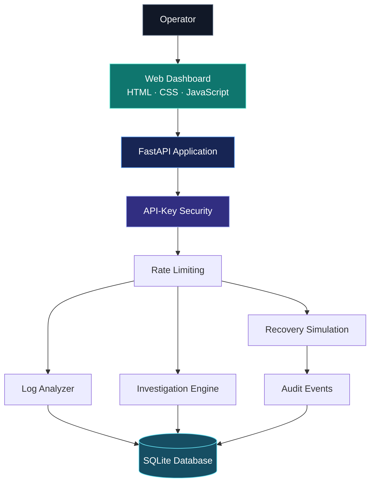
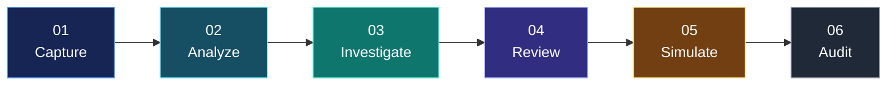

<div align="center">


<br/>

# THE SIGNAL. THE ROOT CAUSE. THE RESPONSE.

**A modern incident investigation and reliability intelligence platform.**

Transform application logs into structured findings, investigate incidents, simulate recovery workflows, and preserve an auditable operational history.

<br/>

<a href="https://aegis-ai-8epd.onrender.com">

</a>
<a href="https://aegis-ai-8epd.onrender.com/docs">

</a>
<a href="https://github.com/akankshad1712/aegis-ai">

</a>

<br/><br/>


<br/><br/>

**DESIGNED WITH INTENT. ENGINEERED WITH PURPOSE.**

[Live Application](https://aegis-ai-8epd.onrender.com) · [API Explorer](https://aegis-ai-8epd.onrender.com/docs) · [Source Code](https://github.com/akankshad1712/aegis-ai)

</div>

---

<div align="center">

## 01 / THE VISION

### Operational complexity, made easier to investigate.

</div>

AEGIS AI is a backend engineering project built around a simple idea: incident information should be easier to analyze, investigate, and trace.

It brings incident records, log-pattern analysis, structured investigation results, simulated recovery actions, and audit events into one application.

The experience combines a lightweight web dashboard with a Python API and persistent data layer, creating a foundation for exploring practical reliability engineering workflows.

<div align="center">

| UNDERSTAND | INVESTIGATE | TRACE |
|:---:|:---:|:---:|
| Analyze log patterns | Generate structured findings | Review recorded events |

</div>

---

## 02 / PRODUCT EXPERIENCE

<table>
<tr>
<td width="50%" valign="top">

### ◈ Incident Command

A unified view of operational issues.

- Incident creation and retrieval
- Status management
- Incident-level investigation
- Historical record access

</td>
<td width="50%" valign="top">

### ⌘ Log Intelligence

Structured analysis of application logs.

- Recognizable error patterns
- Memory-pressure signals
- Input validation
- Structured diagnostic findings

</td>
</tr>
<tr>
<td width="50%" valign="top">

### ✳ Investigation Engine

A repeatable workflow for examining incidents.

- Investigation execution
- Findings based on available information
- Saved investigation history
- Human-reviewable output

</td>
<td width="50%" valign="top">

### ⚡ Recovery Lab

A controlled environment for recovery workflows.

- Recovery-action records
- Explicit simulation approval
- Simulated action outcomes
- Recorded audit events

</td>
</tr>
</table>

> **Engineering principle:** proposed recovery actions remain simulations. They do not execute real infrastructure remediation.

---

## 03 / THE VISUAL LANGUAGE

<div align="center">

| DESIGN ELEMENT | DIRECTION |
|:---|:---|
| Visual identity | Dark, technical, editorial |
| Primary accent | Electric teal |
| Supporting palette | Midnight navy, graphite, cool white |
| Layout inspiration | Figma-style grids and clear hierarchy |
| Information design | Compact metadata, readable tables, clear sections |
| Product tone | Precise, calm, engineering-focused |

</div>

The README uses GitHub-compatible Markdown, HTML, badges, and Mermaid diagrams. Its design language is inspired by premium SaaS dashboards; the GitHub README itself will not behave like an interactive Figma prototype.

---

## 04 / LIVE APPLICATION

<div align="center">

### AEGIS AI — RELIABILITY WORKSPACE

**One application. Multiple investigation workflows.**

<br/>

<a href="https://aegis-ai-8epd.onrender.com">
<strong>↗ Open the live dashboard</strong>
</a>

<br/><br/>

<a href="https://aegis-ai-8epd.onrender.com/docs">
<strong>↗ Explore the interactive REST API</strong>
</a>

<br/><br/>

<a href="https://github.com/akankshad1712/aegis-ai/actions">
<strong>↗ View GitHub Actions</strong>
</a>

</div>

### Add your actual dashboard screenshot

Capture a screenshot of your running application and save it as `docs/images/aegis-dashboard.png`.

Then add this block:

```html
<div align="center">
  
  <p><em>AEGIS AI — Incident and investigation workspace</em></p>
</div>
```

A real screenshot of the application is more valuable to recruiters than a decorative mockup presented as a working product.

---

## 05 / SYSTEM ARCHITECTURE



### Technology architecture

| COMPONENT | TECHNOLOGY | RESPONSIBILITY |
|:---|:---|:---|
| Application backend | Python, FastAPI | API routes and application workflows |
| Web interface | HTML, CSS, JavaScript | Dashboard experience |
| Persistence | SQLite | Incidents and related records |
| Diagnostic logic | Deterministic heuristics | Pattern-based analysis |
| API protection | API-key authentication | Access checks |
| Request controls | SlowAPI | Rate limiting |
| Quality | Pytest | Automated regression testing |
| Containerization | Docker Compose | Reproducible local deployment |
| CI | GitHub Actions | Automated workflow checks |
| Hosting | Render | Public application deployment |

---

## 06 / INCIDENT LIFECYCLE



**01 — Capture:** Create and retrieve incident records.

**02 — Analyze:** Submit logs and identify supported patterns.

**03 — Investigate:** Generate structured findings from available incident information.

**04 — Review:** Inspect findings and proposed actions.

**05 — Simulate:** Approve a supported recovery simulation.

**06 — Audit:** Review recorded workflow events.

### Investigation engine: transparency matters

The current engine is **rule-based and deterministic**, not a trained AI model or an external LLM integration. Its findings are diagnostic suggestions based on recognized patterns, not guaranteed root-cause determinations.

This distinction keeps the product description technically accurate.

---

## 07 / REST API — DEVELOPER INTERFACE

<div align="center">

### YOUR WORKFLOWS. EXPOSED AS HTTP ENDPOINTS.

**Base URL — production**

`https://aegis-ai-8epd.onrender.com`

**Base URL — local**

`http://127.0.0.1:8000`

[**OPEN SWAGGER UI ↗**](https://aegis-ai-8epd.onrender.com/docs)

</div>

### Endpoint catalogue

| METHOD | ROUTE | DESCRIPTION |
|:---|:---|:---|
| `GET` | `/api/health` | Service health check |
| `GET` | `/api/incidents` | List incidents |
| `POST` | `/api/demo/seed` | Seed demonstration data |
| `GET` | `/api/incidents/{id}` | Get incident details |
| `PATCH` | `/api/incidents/{id}/status` | Update incident status |
| `POST` | `/api/logs/analyze` | Analyze submitted logs |
| `POST` | `/api/incidents/{id}/logs/analyze` | Analyze incident logs |
| `POST` | `/api/incidents/{id}/investigate` | Run an investigation |
| `GET` | `/api/incidents/{id}/investigations` | Retrieve investigation history |
| `GET` | `/api/incidents/{id}/actions` | Retrieve recovery actions |
| `POST` | `/api/actions/{action_id}/approve-simulation` | Approve a recovery simulation |
| `GET` | `/api/audit-events` | List audit events |
| `GET` | `/api/incidents/{id}/audit-events` | Retrieve incident audit history |

Confirm request schemas and response models in Swagger UI before integrating a client.

### Authentication contract

Protected API routes use the `X-API-Key` header. `/api/health` is exempt from API-key authentication.

```http
GET /api/incidents HTTP/1.1
Host: localhost:8000
X-API-Key: YOUR_API_KEY
```

### PowerShell API example

```powershell
$headers = @{
    "X-API-Key" = $env:AEGIS_API_KEY
}

Invoke-RestMethod `
    -Uri "http://127.0.0.1:8000/api/incidents" `
    -Method Get `
    -Headers $headers
```

Set the `AEGIS_API_KEY` environment variable before making the request.

**Never commit a real API key.** Keep secrets out of README files, screenshots, source code, and public GitHub issues.

---

## 08 / GET STARTED

### Requirements

- Python version compatible with `requirements.txt`
- Git
- PowerShell on Windows, or a compatible terminal
- Docker Desktop for containerized execution

### 01 — Clone

```powershell
git clone https://github.com/akankshad1712/aegis-ai.git
cd aegis-ai
```

### 02 — Create the environment

```powershell
python -m venv .venv
.\.venv\Scripts\Activate.ps1
```

### 03 — Install dependencies

```powershell
python -m pip install --upgrade pip
pip install -r requirements.txt
```

### 04 — Generate a development API key

```powershell
$env:AEGIS_API_KEY = python -c "import secrets; print(secrets.token_urlsafe(32))"
```

The generated key is available in the current PowerShell session. Keep it private.

### 05 — Run the application

```powershell
python -m uvicorn app.main:app --reload
```

### 06 — Explore

| RESOURCE | URL |
|:---|:---|
| Dashboard | [localhost:8000](http://127.0.0.1:8000/) |
| Swagger | [localhost:8000/docs](http://127.0.0.1:8000/docs) |
| Health | [localhost:8000/api/health](http://127.0.0.1:8000/api/health) |

---

## 09 / CONTAINERIZED DEPLOYMENT

The repository includes Docker and Docker Compose configuration.

Create a `.env` file in the project root:

```dotenv
AEGIS_API_KEY=replace-with-your-random-secret
```

Generate a secret locally:

```powershell
python -c "import secrets; print(secrets.token_urlsafe(32))"
```

Replace the placeholder in `.env`. Do not commit the file.

### Build and start

```powershell
docker compose up --build -d
```

### Check status

```powershell
docker compose ps
```

### Follow logs

```powershell
docker compose logs -f aegis-api
```

### Stop services

```powershell
docker compose down
```

The Compose configuration uses a named volume for the SQLite database. Avoid removing that volume if you need to preserve its data.

---

## 10 / QUALITY ENGINEERING

### Automated testing

Run the test suite from the project root:

```powershell
python -m pytest -v
```

The existing tests cover API workflows, authentication, incident status validation, log analysis, investigation integration, simulated recovery, and audit events.

<div align="center">

<a href="https://github.com/akankshad1712/aegis-ai/actions">

</a>

</div>

**Previously verified:** 13 tests passed locally, and the GitHub Actions workflow passed. These are historical results; run the tests against the current checkout to confirm its present state.

---

## 11 / REPOSITORY MAP

```text
aegis-ai/
├── app/
│   ├── __init__.py
│   ├── db.py
│   ├── engine.py
│   ├── limiter.py
│   ├── log_analyzer.py
│   ├── main.py
│   ├── security.py
│   └── static/
│       └── index.html
├── tests/
│   ├── test_api.py
│   ├── test_log_integration.py
│   ├── test_security.py
│   ├── test_audit_logging.py
│   └── test_log_analyzer.py
├── .github/
│   └── workflows/
│       └── ci.yml
├── .dockerignore
├── .gitignore
├── Dockerfile
├── docker-compose.yml
├── requirements.txt
└── README.md
```

---

## 12 / SECURITY & OPERATIONAL NOTES

AEGIS AI includes API-key checks, rate limiting, validation, and audit-event recording. These controls are a foundation, not a substitute for a production security review.

- Use a strong, randomly generated API key.
- Configure secrets in the hosting provider's environment settings.
- Rotate credentials that have been exposed.
- Never commit `.env`, database files, or sensitive logs.
- Review diagnostic output before making operational decisions.
- Recovery approval triggers a simulation, not real infrastructure remediation.
- Configure durable database storage for records that must survive restarts.
- Apply additional authorization and operational safeguards before public production use.

### Hosting considerations

The deployed demo uses a free hosting configuration. The service may sleep after inactivity, and data held on an ephemeral filesystem may be lost when the instance restarts or redeploys.

---

## 13 / PRODUCT ROADMAP

- [ ] Add a real application screenshot and walkthrough.
- [ ] Improve incident search and filtering.
- [ ] Expand diagnostic patterns and regression coverage.
- [ ] Add evidence references to investigation findings.
- [ ] Configure persistent managed database storage.
- [ ] Introduce role-based access controls.
- [ ] Improve monitoring, metrics, and structured logging.
- [ ] Explore optional LLM-assisted explanations grounded in incident evidence.
- [ ] Develop authorized infrastructure integrations with safeguards.

---

## 14 / ENGINEERING PORTFOLIO

| AREA | DEMONSTRATED IN AEGIS AI |
|:---|:---|
| Backend engineering | FastAPI application and incident workflows |
| API development | REST routes and request handling |
| Data persistence | SQLite-backed records |
| Security fundamentals | API-key authentication and rate limiting |
| Testing | Pytest and regression tests |
| DevOps | Docker and Docker Compose |
| CI automation | GitHub Actions |
| Reliability concepts | Log analysis and incident investigation |
| Auditability | Recorded workflow events |
| Safe automation | Recovery simulation |

AEGIS AI brings these skills together in a single project that can be explored through a live interface, an API documentation page, and a public source repository.

---

## 15 / CONTRIBUTING

Contributions and suggestions are welcome.

1. Fork the repository.
2. Create a feature branch.
3. Make your change.
4. Add or update tests.
5. Run the test suite.
6. Submit a pull request describing the change.

Do not include credentials, private logs, or other sensitive operational data in contributions.

---

<div align="center">


<br/>

### AKANKSHA DESHMUKH

**Software Engineering · Backend Development · API Engineering**

<br/>

<a href="https://github.com/akankshad1712">

</a>
<a href="https://github.com/akankshad1712/aegis-ai">

</a>
<a href="https://aegis-ai-8epd.onrender.com">

</a>

<br/><br/>

*Engineering a clearer path from operational signal to actionable insight.*

</div>
