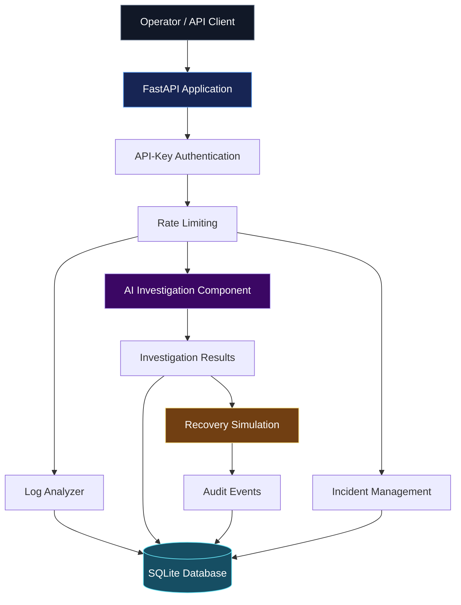
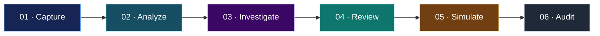

<div align="center">


<br/>

# INVESTIGATE WITH CLARITY. ENGINEER WITH CONFIDENCE.

### AI-ASSISTED INCIDENT INVESTIGATION & RELIABILITY ENGINEERING

A modern backend platform combining incident management, log intelligence, AI-assisted investigations, controlled recovery simulations, and auditable operational workflows.

<br/>

<a href="https://aegis-ai-8epd.onrender.com">

</a>
<a href="https://aegis-ai-8epd.onrender.com/docs">

</a>
<a href="https://github.com/akankshad1712/aegis-ai">

</a>

<br/><br/>


<br/><br/>

**BACKEND ENGINEERING · AI INTEGRATION · API SECURITY · RELIABILITY**

[Live Application](https://aegis-ai-8epd.onrender.com) · [API Explorer](https://aegis-ai-8epd.onrender.com/docs) · [GitHub Repository](https://github.com/akankshad1712/aegis-ai)

</div>

---

## 01 — PRODUCT VISION

### From operational signals to structured investigations.

Modern applications generate logs, incidents, errors, and operational events. Understanding these signals requires a workflow that makes information easier to analyze, investigate, and trace.

**AEGIS AI** brings incident records, diagnostic log analysis, investigation workflows, recovery simulations, and audit history into a unified backend application.

The platform is designed around three principles:

| PRINCIPLE | ENGINEERING APPROACH |
|---|---|
| Clarity | Convert operational signals into structured findings |
| Traceability | Preserve investigation history and audit events |
| Controlled automation | Keep recovery simulations separate from real infrastructure changes |

## 02 — PLATFORM CAPABILITIES

<table>
<tr>
<td width="50%" valign="top">

### ◈ Incident Management

- Create and retrieve incidents
- Update incident status
- Access incident details
- Associate investigations with incidents
- Preserve operational records

</td>
<td width="50%" valign="top">

### ⌘ Log Intelligence

- Analyze submitted application logs
- Detect supported error patterns
- Identify diagnostic signals
- Validate incoming data
- Generate structured findings

</td>
</tr>
<tr>
<td width="50%" valign="top">

### ✳ AI-Assisted Investigation

- OpenAI Agents SDK integration
- Configurable AI model settings
- Investigation execution
- Persisted investigation history
- Reviewable investigation results

</td>
<td width="50%" valign="top">

### ⚡ Recovery Simulation

- Record proposed recovery actions
- Support explicit simulation approval
- Record simulated outcomes
- Maintain audit events
- Separate simulation from real remediation

</td>
</tr>
</table>

> **Safety by design:** recovery approval records a simulation, not real infrastructure remediation. Findings should be reviewed before operational decisions are made.

## 03 — SYSTEM ARCHITECTURE



### Technology stack

| LAYER | TECHNOLOGY | PURPOSE |
|---|---|---|
| Backend | Python, FastAPI | API endpoints and application workflows |
| AI integration | OpenAI Agents SDK | AI-assisted investigation |
| Data persistence | SQLite | Incident and investigation records |
| Security | API-key authentication | Protected API access |
| Request control | Rate limiting | Request-volume management |
| Testing | pytest, HTTPX | Automated quality checks |
| Containerization | Docker, Docker Compose | Consistent application deployment |
| Configuration | Environment variables, python-dotenv | Runtime configuration |
| CI | GitHub Actions | Automated workflow validation |
| Hosting | Render | Live application deployment |

## 04 — INCIDENT LIFECYCLE



1. **Capture:** create or retrieve an incident.
2. **Analyze:** examine logs for supported diagnostic patterns.
3. **Investigate:** execute the configured investigation workflow.
4. **Review:** inspect findings and proposed recovery actions.
5. **Simulate:** record a supported recovery simulation.
6. **Audit:** review persisted investigation and operational events.

## 05 — AGENTIC AI & INTELLIGENCE

AEGIS AI includes an AI investigation component intended to support structured incident analysis.

The project's AI integration is configured through environment variables and works alongside the application's backend, database, and deterministic diagnostic logic.

### AI engineering concepts

- OpenAI Agents SDK integration
- Model configuration
- Python backend integration
- Incident investigation workflows
- Structured application data
- Persistent investigation records
- Human review of generated findings
- Separation of diagnostic logic and AI-assisted reasoning

**Important distinction:** an AI SDK integration alone does not prove that an application implements a fully autonomous agent. Autonomous planning, tool calling, multi-agent orchestration, and self-directed remediation should be claimed only where the source code implements those capabilities.

## 06 — LIVE PRODUCT

<div align="center">

### AEGIS AI / RELIABILITY WORKSPACE

**One platform. Structured investigation workflows.**

<br/>

<a href="https://aegis-ai-8epd.onrender.com"><strong>↗ OPEN LIVE APPLICATION</strong></a>

<br/><br/>

<a href="https://aegis-ai-8epd.onrender.com/docs"><strong>↗ EXPLORE INTERACTIVE API DOCUMENTATION</strong></a>

<br/><br/>

<a href="https://github.com/akankshad1712/aegis-ai/actions"><strong>↗ VIEW CI WORKFLOWS</strong></a>

</div>

### Dashboard preview

For the strongest portfolio presentation, add an actual screenshot of your running application at `docs/images/aegis-dashboard.png`.

```html
<div align="center">
  
  <p><em>AEGIS AI — Operational investigation workspace</em></p>
</div>
```

Use this preview only after adding the image file to your repository.

## 07 — REST API

The live Swagger interface provides the authoritative endpoint list, request schemas, and response models.

- **Production:** [Interactive API documentation](https://aegis-ai-8epd.onrender.com/docs)
- **Local:** `http://127.0.0.1:8000/docs`

### Authentication

Protected API routes use the `X-API-Key` header. The `/api/health` endpoint is exempt from API-key authentication.

Example PowerShell request:

```powershell
$headers = @{
    "X-API-Key" = $env:AEGIS_API_KEY
}

Invoke-RestMethod `
    -Uri "http://127.0.0.1:8000/api/incidents" `
    -Method Get `
    -Headers $headers
```

Set `AEGIS_API_KEY` in the current PowerShell session before making the request.

## 08 — QUICK START

### Prerequisites

- Python 3.12 recommended
- Git
- An OpenAI API key for AI-powered workflows
- Docker Desktop for containerized execution

### 01. Clone the repository

```powershell
git clone https://github.com/akankshad1712/aegis-ai.git
cd aegis-ai
```

### 02. Create a virtual environment

```powershell
python -m venv .venv
.\.venv\Scripts\Activate.ps1
```

### 03. Install dependencies

```powershell
python -m pip install --upgrade pip
python -m pip install -r requirements.txt
```

### 04. Configure environment variables

Create a local environment file:

```powershell
Copy-Item .env.example .env
```

Update `.env` with your own values:

```dotenv
AEGIS_API_KEY=replace-with-a-long-random-secret
OPENAI_API_KEY=your-openai-api-key
AEGIS_AGENT_MODEL=gpt-4.1-mini
```

Replace all placeholders before running the application. Never commit real credentials.

### 05. Start the application

```powershell
python -m uvicorn app.main:app --reload
```

### 06. Explore the application

| RESOURCE | LOCAL ADDRESS |
|---|---|
| Dashboard | [http://127.0.0.1:8000/](http://127.0.0.1:8000/) |
| Swagger UI | [http://127.0.0.1:8000/docs](http://127.0.0.1:8000/docs) |
| Health check | [http://127.0.0.1:8000/api/health](http://127.0.0.1:8000/api/health) |

## 09 — DOCKER DEPLOYMENT

AEGIS AI includes Docker and Docker Compose configuration for containerized execution.

### Build and start

```powershell
docker compose up --build -d
```

### Inspect container status

```powershell
docker compose ps
```

### Follow application logs

```powershell
docker compose logs -f aegis-api
```

### Stop the application

```powershell
docker compose down
```

The container is configured to store its SQLite database at `/data/aegis.db`, using a named Docker volume for persistence.

Ensure `OPENAI_API_KEY` and `AEGIS_AGENT_MODEL` are passed to the container if the agent implementation requires them. Host environment variables are not automatically available inside containers unless explicitly configured.

**Data safety:** avoid `docker compose down -v` if you need to preserve the database volume.

## 10 — TESTING & QUALITY ENGINEERING

Run the automated test suite:

```powershell
python -m pytest -v
```

Check dependency consistency:

```powershell
python -m pip check
```

Compile application modules:

```powershell
python -m compileall -q app
```

The latest reported local verification was **19 passing tests**. Run these commands on the current checkout to confirm its present state.

CI workflows: [GitHub Actions](https://github.com/akankshad1712/aegis-ai/actions).

## 11 — PROJECT STRUCTURE

```text
aegis-ai/
├── app/
│   ├── agent.py
│   ├── db.py
│   ├── main.py
│   └── supporting application modules
├── tests/
├── .github/
│   └── workflows/
├── .dockerignore
├── .gitignore
├── .env.example
├── Dockerfile
├── docker-compose.yml
├── requirements.txt
└── README.md
```

## 12 — SECURITY & RELIABILITY

The project incorporates foundational controls to support safer API operations.

- API-key authentication for protected routes
- Constant-time API-key comparison
- Request rate limiting
- Environment-based configuration
- Automated regression testing
- Audit-event recording
- Persistent application records
- Controlled recovery simulations

### Operational considerations

- Use strong, unique API keys.
- Store secrets in environment variables or a managed secrets service.
- Never commit `.env`, database files, or sensitive logs.
- Use HTTPS for externally accessible deployments.
- Review AI-generated findings before operational decisions.
- Configure durable storage for important records.
- Apply appropriate authorization, monitoring, and retention policies before production use.

The public demo may sleep after inactivity. Data persistence depends on the hosting provider's storage configuration.

## 13 — ENGINEERING ROADMAP

- [ ] Add a verified dashboard screenshot and walkthrough.
- [ ] Improve incident search and filtering.
- [ ] Expand diagnostic patterns and regression coverage.
- [ ] Associate investigation findings with supporting evidence.
- [ ] Strengthen database persistence and deployment configuration.
- [ ] Evaluate role-based access control.
- [ ] Improve monitoring and structured diagnostics.
- [ ] Explore evidence-grounded AI investigation enhancements.
- [ ] Evaluate authorized infrastructure integrations with safeguards.

*Roadmap items represent planned improvements, not necessarily existing features.*

## 14 — ENGINEERING SKILLS DEMONSTRATED

| DOMAIN | IMPLEMENTATION |
|---|---|
| Backend engineering | Python, FastAPI, modular application workflows |
| API development | REST endpoints and request handling |
| AI integration | OpenAI Agents SDK integration |
| Data engineering fundamentals | SQLite, SQL, persisted records |
| Application security | API-key authentication and rate limiting |
| Quality engineering | pytest and regression testing |
| DevOps | Docker, Docker Compose, persistent volumes |
| CI automation | GitHub Actions |
| Reliability engineering | Log analysis and incident investigation |
| Auditability | Persisted workflow events |
| Safe automation | Recovery simulation |
| Developer experience | Swagger documentation and setup instructions |

## 15 — CONTRIBUTING

Contributions and technical suggestions are welcome.

1. Fork the repository.
2. Create a feature branch.
3. Implement a focused change.
4. Add or update automated tests.
5. Run the test suite.
6. Submit a pull request with a clear explanation.

Never include credentials or sensitive operational data in contributions.

---

<div align="center">


<br/>

### AKANKSHA DESHMUKH

**Software Engineering · Backend Development · AI Integration**

[GitHub Profile](https://github.com/akankshad1712) · [AEGIS AI Repository](https://github.com/akankshad1712/aegis-ai) · [Live Application](https://aegis-ai-8epd.onrender.com)

<br/>

*Engineering a clearer path from operational signal to actionable insight.*

</div>
