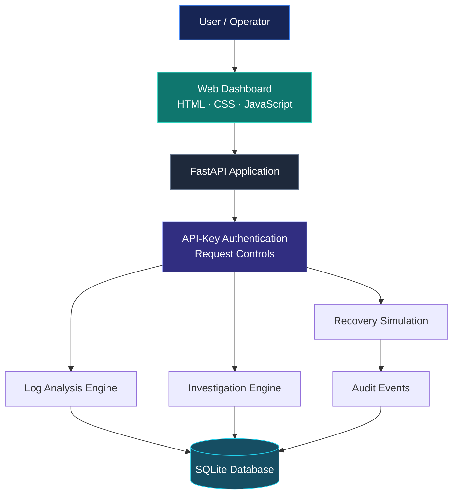

<div align="center">


<br/>

### ENGINEERED FOR CLARITY. DESIGNED FOR RELIABILITY.

A modern incident investigation platform that transforms application logs and incident records into structured findings, traceable investigation workflows, and auditable recovery simulations.

<br/>

<a href="https://aegis-ai-8epd.onrender.com">
  
</a>
<a href="https://github.com/akankshad1712/aegis-ai">
  
</a>
<a href="https://aegis-ai-8epd.onrender.com/docs">
  
</a>

<br/><br/>


<br/>

**Built by [Akanksha Deshmukh](https://github.com/akankshad1712)**

</div>

---

## ◈ THE VISION

Modern software systems generate logs, errors, alerts, and operational events. Understanding what happened, why it happened, and what to investigate next can be challenging.

**AEGIS AI brings the incident investigation workflow into one place.**

It combines log-pattern analysis, incident management, structured investigation reports, recovery-action simulations, and audit history through a web dashboard and REST API.

The goal is simple: make operational investigations more understandable, consistent, and traceable.

> **Detect the signal. Investigate the cause. Explain the findings. Simulate recovery. Preserve the trail.**

---

## ◈ PRODUCT EXPERIENCE

<div align="center">

<table>
<tr>
<td width="50%" valign="top">

### 01 / INCIDENT MANAGEMENT

Organize operational issues in a centralized incident queue.

- Create and inspect incident records
- Track incident status
- Retrieve incident details
- Maintain investigation context

</td>
<td width="50%" valign="top">

### 02 / LOG INTELLIGENCE

Analyze application logs using recognizable patterns and deterministic rules.

- Identify relevant error patterns
- Detect potential memory-pressure signals
- Produce structured analysis findings
- Handle empty and malformed log inputs

</td>
</tr>
<tr>
<td width="50%" valign="top">

### 03 / INVESTIGATION ENGINE

Turn available incident information into structured investigation results.

- Run incident investigations
- Incorporate available log-analysis findings
- Review investigation history
- Support human-readable diagnostic workflows

</td>
<td width="50%" valign="top">

### 04 / RECOVERY SIMULATION

Explore recovery workflows without modifying real infrastructure.

- Inspect available recovery actions
- Approve supported simulations
- Track action records
- Review recorded outcomes

</td>
</tr>
<tr>
<td width="50%" valign="top">

### 05 / AUDIT & TRACEABILITY

Maintain a record of important application workflows.

- Incident status events
- Investigation records
- Recovery-action events
- Audit-event inspection

</td>
<td width="50%" valign="top">

### 06 / API & ENGINEERING

Built around a documented backend and repeatable development workflow.

- FastAPI REST endpoints
- API-key protection
- Rate limiting
- Docker-based execution
- Automated test workflow

</td>
</tr>
</table>

</div>

---

## ◈ SYSTEM ARCHITECTURE



### Technology stack

| Layer | Technologies |
|---|---|
| Backend | Python, FastAPI |
| Frontend | HTML, CSS, JavaScript |
| Database | SQLite |
| Investigation logic | Deterministic, rule-based heuristics |
| API security | API-key authentication |
| Request protection | Rate limiting and request handling |
| Testing | Pytest |
| Containerization | Docker, Docker Compose |
| Continuous integration | GitHub Actions |
| Hosting | Render |

---

## ◈ HOW THE INVESTIGATION WORKFLOW WORKS


1. **Create** — register an incident for investigation.
2. **Analyze** — process submitted application logs and identify supported patterns.
3. **Investigate** — generate structured results using available incident information.
4. **Review** — examine findings and available recovery actions.
5. **Simulate** — approve a supported recovery simulation.
6. **Audit** — inspect the records generated by the workflow.

### Investigation approach

AEGIS AI currently uses **deterministic, rule-based heuristics**, not a trained machine-learning model or an external generative AI service.

The engine identifies supported patterns and produces structured findings. These findings are diagnostic suggestions, not guaranteed root-cause conclusions. Human review remains important.

---

## ◈ LIVE DEPLOYMENT

<div align="center">

### AEGIS AI / LIVE ENVIRONMENT

**Production-style deployment for demonstration and portfolio evaluation**

| Resource | Link |
|---|---|
| Web dashboard | [Launch AEGIS AI](https://aegis-ai-8epd.onrender.com) |
| Interactive API documentation | [Open Swagger UI](https://aegis-ai-8epd.onrender.com/docs) |
| Health endpoint | [Check API health](https://aegis-ai-8epd.onrender.com/api/health) |
| Source repository | [GitHub repository](https://github.com/akankshad1712/aegis-ai) |

</div>

**Deployment notes**

- The service is hosted on Render.
- A free instance may take time to wake after inactivity.
- Protected endpoints require the configured API key.
- SQLite data may not persist across restarts or redeployments when stored on an ephemeral filesystem.
- Recovery operations are simulations and do not modify actual infrastructure.

---

## ◈ REST API REFERENCE

The following table summarizes the API routes implemented in the project. Open Swagger UI for the current request schemas, parameters, and response formats.

| Method | Endpoint | Description |
|---|---|---|
| `GET` | `/api/health` | Check application health |
| `GET` | `/api/incidents` | List incidents |
| `POST` | `/api/demo/seed` | Seed demonstration data |
| `GET` | `/api/incidents/{id}` | Retrieve an incident |
| `PATCH` | `/api/incidents/{id}/status` | Update incident status |
| `POST` | `/api/logs/analyze` | Analyze submitted logs |
| `POST` | `/api/incidents/{id}/logs/analyze` | Analyze incident logs |
| `POST` | `/api/incidents/{id}/investigate` | Run an investigation |
| `GET` | `/api/incidents/{id}/investigations` | Retrieve investigation history |
| `GET` | `/api/incidents/{id}/actions` | List recovery actions |
| `POST` | `/api/actions/{action_id}/approve-simulation` | Approve a recovery simulation |
| `GET` | `/api/audit-events` | List audit events |
| `GET` | `/api/incidents/{id}/audit-events` | Inspect incident audit history |

### Authentication

Protected API routes use the `X-API-Key` request header.

Example:

```http
GET /api/incidents HTTP/1.1
Host: localhost:8000
X-API-Key: YOUR_API_KEY
```

Example with PowerShell:

```powershell
$headers = @{
    "X-API-Key" = $env:AEGIS_API_KEY
}

Invoke-RestMethod `
    -Uri "http://127.0.0.1:8000/api/incidents" `
    -Headers $headers `
    -Method Get
```

Set the environment variable before running the command. Never paste a real API key into source code, documentation, screenshots, or public issue reports.

---

## ◈ QUICK START

### Prerequisites

- Python 3.11 or another version supported by the project dependencies
- Git
- Docker Desktop for the containerized setup

### 01 / Clone

```bash
git clone https://github.com/akankshad1712/aegis-ai.git
cd aegis-ai
```

### 02 / Create the virtual environment

Windows PowerShell:

```powershell
python -m venv .venv
.\.venv\Scripts\Activate.ps1
```

### 03 / Install dependencies

```powershell
python -m pip install --upgrade pip
pip install -r requirements.txt
```

### 04 / Configure the API key

Generate a strong local development secret:

```powershell
$env:AEGIS_API_KEY = python -c "import secrets; print(secrets.token_urlsafe(32))"
```

Keep the generated value private. This command sets the variable for the current PowerShell session.

### 05 / Start the server

```powershell
python -m uvicorn app.main:app --reload
```

### 06 / Open the application

| Resource | Local URL |
|---|---|
| Dashboard | http://127.0.0.1:8000/ |
| Swagger UI | http://127.0.0.1:8000/docs |
| Health check | http://127.0.0.1:8000/api/health |

---

## ◈ DOCKER DEPLOYMENT

The repository includes Docker and Docker Compose configuration.

### Configure environment variables

Create a local `.env` file in the repository root:

```dotenv
AEGIS_API_KEY=replace-with-a-strong-random-secret
```

Replace the placeholder with a newly generated secret. Do not commit `.env` to Git.

### Build and start

```powershell
docker compose up --build -d
```

### Inspect container status

```powershell
docker compose ps
```

### View application logs

```powershell
docker compose logs -f aegis-api
```

### Stop the service

```powershell
docker compose down
```

The Compose configuration uses a named database volume. Avoid deleting that volume if you need to retain the local SQLite data.

---

## ◈ TESTING & CONTINUOUS INTEGRATION

Run the test suite:

```powershell
python -m pytest -v
```

The existing tests cover areas including:

- API health and incident workflows
- Investigation and simulated action flows
- API-key authentication
- Audit-event creation
- Incident status validation
- Log parsing and malformed input
- Empty-log handling
- Memory-pressure pattern detection
- Use of saved log-analysis results during investigation

**Previously verified:** 13 local tests passed, and the reported GitHub Actions workflow passed.

[](https://github.com/akankshad1712/aegis-ai/actions)

---

## ◈ SECURITY & RELIABILITY

Security considerations built into the current project include API-key checks, request controls, input validation, and audit-event recording.

For responsible deployment:

- Use a unique, randomly generated API key.
- Store secrets in environment variables or your hosting provider's secret settings.
- Never commit `.env` files, database files, or credentials.
- Keep development and hosted secrets separate.
- Review authorization and rate-limiting behavior before wider public use.
- Avoid exposing sensitive production logs through a public demo.
- Treat diagnostic output as a hypothesis requiring human review.

**Scope:** This is a portfolio engineering project. API-key authentication alone does not establish production-grade security, and simulated recovery is not real automated remediation.

---

## ◈ PROJECT STRUCTURE

```text
aegis-ai/
├── app/
│   ├── __init__.py
│   ├── db.py
│   ├── engine.py
│   ├── limiter.py
│   ├── log_analyzer.py
│   ├── main.py
│   ├── security.py
│   └── static/
│       └── index.html
├── tests/
│   ├── test_api.py
│   ├── test_log_integration.py
│   ├── test_security.py
│   ├── test_audit_logging.py
│   └── test_log_analyzer.py
├── .github/
│   └── workflows/
│       └── ci.yml
├── .dockerignore
├── .gitignore
├── Dockerfile
├── docker-compose.yml
├── requirements.txt
└── README.md
```

---

## ◈ ENGINEERING HIGHLIGHTS

AEGIS AI demonstrates practical work across several software engineering areas:

| Area | What the project demonstrates |
|---|---|
| Backend development | FastAPI routes and service workflows |
| API design | REST endpoints and structured responses |
| Data persistence | SQLite-backed incident records |
| Security fundamentals | API-key validation and request protection |
| Testing | Automated tests using Pytest |
| Containerization | Docker image and Compose workflow |
| CI | GitHub Actions automation |
| Reliability concepts | Log analysis, investigation, and audit trails |
| Safe automation | Explicit recovery simulation instead of real infrastructure changes |

These are project capabilities, not a claim of production-scale experience or autonomous AI.

---

## ◈ ROADMAP

Potential future improvements:

- [ ] Add dashboard screenshots and an architecture overview image.
- [ ] Improve incident filtering, sorting, and visual analytics.
- [ ] Add richer evidence references to investigation findings.
- [ ] Expand log-pattern coverage and regression testing.
- [ ] Introduce persistent managed database storage.
- [ ] Add role-based access control.
- [ ] Strengthen audit integrity and observability.
- [ ] Explore optional LLM-assisted investigation with evidence-grounded explanations.
- [ ] Add real infrastructure integrations behind explicit authorization and safeguards.

---

## ◈ CONTRIBUTING

Suggestions, bug reports, and improvements are welcome.

1. Fork the repository.
2. Create a feature branch.
3. Make your changes and add tests where appropriate.
4. Run the test suite.
5. Submit a pull request with a clear description.

Please do not include API keys, credentials, private logs, or sensitive operational data.

---

## ◈ ABOUT THE DEVELOPER

<div align="center">

### AKANKSHA DESHMUKH

**Software Engineering · Backend Development · API Engineering**

Building practical software systems with an emphasis on clean workflows, secure API design, testability, and reliability.

<br/>

<a href="https://github.com/akankshad1712">
  
</a>
<a href="https://github.com/akankshad1712/aegis-ai">
  
</a>
<a href="https://aegis-ai-8epd.onrender.com">
  
</a>

<br/><br/>

*Designed to make incident investigation more explainable, traceable, and reliable.*

**AEGIS AI — Detect. Investigate. Explain. Recover.**

</div>
