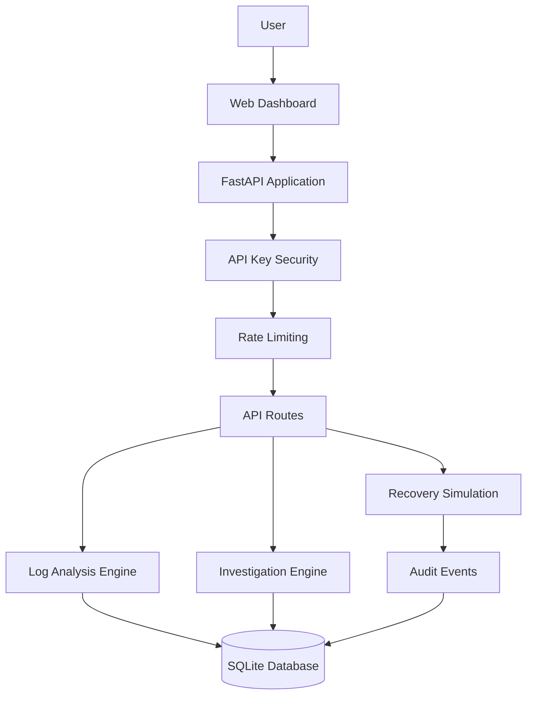

<div align="center">

# ⚡ AEGIS AI

### AI-Powered Incident Investigation & Reliability Intelligence

**Detect. Investigate. Explain. Recover — Safely.**

A modern incident investigation platform that analyzes application logs, organizes incidents, generates structured investigation reports, and tracks simulated recovery actions with audit history.

<br/>

[](https://www.python.org/)
[](https://fastapi.tiangolo.com/)
[](https://www.docker.com/)
[](https://www.sqlite.org/)
[](https://github.com/akankshad1712/aegis-ai/actions)

<br/>

**[🌐 Live Demo](https://aegis-ai-8epd.onrender.com) · [💻 Source Code](https://github.com/akankshad1712/aegis-ai) · [📚 API Docs](https://aegis-ai-8epd.onrender.com/docs)**

</div>

---

## ✨ Overview

AEGIS AI is a reliability intelligence project designed to make incident investigation more structured, explainable, and auditable.

Instead of treating logs as isolated text, AEGIS AI brings together incident records, log analysis, investigation findings, recovery-action simulations, and audit events in one dashboard.

The platform combines a **deterministic, rule-based investigation engine** with a FastAPI backend and a web-based dashboard. It is designed as a practical foundation for exploring incident management, backend engineering, API security, and operational reliability workflows.

> **Design principle:** Every investigation should produce understandable findings, every simulated action should be traceable, and every important operation should leave an audit trail.

## 🚀 Key Features

<table>
<tr>
<td width="50%" valign="top">

### 🔎 Log Intelligence
- Analyze application logs
- Identify recognizable error patterns
- Highlight potential memory pressure and other operational signals
- Generate structured analysis results

</td>
<td width="50%" valign="top">

### 🧠 Incident Investigation
- Create and manage incidents
- Generate structured investigation reports
- Connect log-analysis findings to investigations
- Review investigation history

</td>
</tr>
<tr>
<td width="50%" valign="top">

### 🛡️ Secure API
- API-key authentication
- Protected API endpoints
- Request identification and logging
- Rate limiting
- Input validation and error handling

</td>
<td width="50%" valign="top">

### ⚙️ Recovery Simulation
- Review proposed recovery actions
- Approve supported actions for simulation
- Track action status
- Record operational audit events

</td>
</tr>
<tr>
<td width="50%" valign="top">

### 📋 Auditability
- Incident status history
- Investigation records
- Recovery-action records
- Audit-event inspection

</td>
<td width="50%" valign="top">

### 🐳 Deployment & Testing
- Docker containerization
- Docker Compose support
- Automated GitHub Actions workflow
- Pytest-based API and security tests

</td>
</tr>
</table>

## 🖥️ Live Application

**Try AEGIS AI:** [aegis-ai-8epd.onrender.com](https://aegis-ai-8epd.onrender.com)

The application provides a dashboard for exploring incident investigation workflows.

| Component | Purpose |
|---|---|
| Incident Queue | View and manage incident records |
| Log Analyzer | Inspect logs for recognizable patterns |
| Investigation Reports | Review structured findings |
| Recovery Actions | Inspect and simulate supported actions |
| Audit Timeline | Review recorded operational events |

> **Demo note:** The public service may take time to wake up after inactivity on its free hosting tier. SQLite data on an ephemeral filesystem may not persist across restarts or redeployments.

## 🏗️ Architecture



### Technology Stack

| Layer | Technologies |
|---|---|
| Backend | Python, FastAPI |
| Investigation | Deterministic, rule-based analysis |
| Database | SQLite |
| Frontend | HTML, CSS, JavaScript |
| API Security | API-key authentication |
| Rate Limiting | SlowAPI |
| Testing | Pytest |
| Containerization | Docker, Docker Compose |
| CI | GitHub Actions |
| Hosting | Render |

## 🔄 How It Works

1. **Create an incident** — Register an operational issue through the dashboard or API.
2. **Analyze logs** — Submit application logs for pattern detection and structured analysis.
3. **Investigate** — Generate an investigation using available incident information and analysis findings.
4. **Review recommendations** — Inspect the investigation report and available recovery actions.
5. **Simulate recovery** — Approve a supported simulation and record its outcome.
6. **Audit the workflow** — Review stored investigation, action, and audit-event records.

### Investigation Method

AEGIS AI currently uses deterministic heuristics and recognizable log patterns rather than a trained machine-learning model or an external generative AI service.

This approach makes the current behavior suitable for testing, demonstrations, and learning about explainable operational workflows. Findings should be treated as diagnostic suggestions, not guaranteed root-cause conclusions.

## 🧰 Getting Started

### Prerequisites

Install the following:

- Python 3.11 or a compatible version supported by the dependencies
- Git
- Docker Desktop, if using the containerized setup

### 1. Clone the repository

```bash
git clone https://github.com/akankshad1712/aegis-ai.git
cd aegis-ai
```

### 2. Create a virtual environment

**Windows PowerShell**

```powershell
python -m venv .venv
.\.venv\Scripts\Activate.ps1
```

If PowerShell blocks activation, you can run the environment's Python executable directly instead.

### 3. Install dependencies

```powershell
python -m pip install --upgrade pip
pip install -r requirements.txt
```

### 4. Configure your API key

Set a strong, randomly generated API key in your terminal for local development.

```powershell
$env:AEGIS_API_KEY = python -c "import secrets; print(secrets.token_urlsafe(32))"
```

To use a persistent local `.env` file, create it from the variables your application expects. Never commit your real `.env` file.

### 5. Start the application

```powershell
python -m uvicorn app.main:app --reload
```

Open these URLs:

| Resource | URL |
|---|---|
| Dashboard | http://127.0.0.1:8000/ |
| API documentation | http://127.0.0.1:8000/docs |
| Health endpoint | http://127.0.0.1:8000/api/health |

**Note:** Protected API endpoints require the configured API key. The health endpoint is exempt from API-key authentication.

## 🐳 Run with Docker Compose

The repository includes Docker configuration for running the application in a container.

### 1. Create a local environment file

Create `.env` in the project root:

```dotenv
AEGIS_API_KEY=replace-with-a-strong-random-secret
```

Generate a strong secret using Python:

```powershell
python -c "import secrets; print(secrets.token_urlsafe(32))"
```

Copy the generated value into `.env`. Do not publish it.

### 2. Build and start

```powershell
docker compose up --build -d
```

### 3. Check container health

```powershell
docker compose ps
docker compose logs -f aegis-api
```

### 4. Stop the application

```powershell
docker compose down
```

The Docker Compose configuration uses a named volume for the SQLite database. Keep the volume when stopping the service if you want to preserve its local data.

## 🔌 API Overview

The application exposes REST endpoints for health checks, incidents, log analysis, investigations, simulated actions, and audit events.

| Method | Endpoint | Purpose |
|---|---|---|
| GET | `/api/health` | Check service health |
| GET | `/api/incidents` | List incidents |
| POST | `/api/demo/seed` | Seed demo data |
| GET | `/api/incidents/{id}` | Retrieve an incident |
| PATCH | `/api/incidents/{id}/status` | Update incident status |
| POST | `/api/logs/analyze` | Analyze submitted logs |
| POST | `/api/incidents/{id}/logs/analyze` | Analyze logs for an incident |
| POST | `/api/incidents/{id}/investigate` | Run an investigation |
| GET | `/api/incidents/{id}/investigations` | Retrieve investigation history |
| GET | `/api/incidents/{id}/actions` | List recovery actions |
| POST | `/api/actions/{action_id}/approve-simulation` | Approve a simulated action |
| GET | `/api/audit-events` | Inspect audit events |

For request schemas, parameters, and response models, see the interactive [Swagger API documentation](https://aegis-ai-8epd.onrender.com/docs).

> These endpoints describe the intended API surface. Refer to Swagger for the deployed version's current request and response schemas.

## 🧪 Testing

Run the test suite from the repository root:

```powershell
python -m pytest -v
```

The existing test suite covers areas including:

- API health and incident workflows
- Investigation and simulated recovery flows
- Audit logging and incident status validation
- Log parsing and malformed or empty input
- Memory-pressure pattern detection
- API-key authentication

The last reported local test run passed **13 tests**. The GitHub Actions workflow has also passed in the reported run.

## 🔐 Security Considerations

AEGIS AI includes API-key protection for protected API routes and records important workflow events.

For safe operation:

- Generate strong, unique API keys.
- Store secrets in environment variables or your hosting provider's secret configuration.
- Never commit `.env`, database files, or credentials.
- Keep production secrets separate from development secrets.
- Review audit records and application logs.
- Validate access controls before exposing the service to untrusted users.
- Avoid sending sensitive production logs to a public demo.

**Important:** API-key authentication is only one security layer. A public deployment should also be assessed for authorization, request-size limits, input handling, abuse prevention, and data retention.

## ⚠️ Current Limitations

AEGIS AI is a portfolio and engineering project, not a fully autonomous production incident-response system.

- Investigation findings are based on deterministic heuristics.
- Recovery operations are simulations and do not modify real infrastructure.
- SQLite persistence depends on the configured storage environment.
- A free hosting instance may sleep during inactivity.
- Diagnostic findings can be incomplete or incorrect and require human review.

## 🛣️ Roadmap

Potential future improvements:

- [ ] Add richer investigation explanations and evidence references.
- [ ] Add more log-pattern rules and regression tests.
- [ ] Introduce persistent managed database storage for production-like deployment.
- [ ] Improve incident filtering, search, and dashboard visualization.
- [ ] Add role-based access control and stronger audit protections.
- [ ] Add metrics, structured logging, and observability integrations.
- [ ] Explore optional LLM-assisted investigation with evidence-grounded outputs.
- [ ] Add real infrastructure integrations behind explicit authorization and safeguards.

## 🤝 Contributing

Contributions, suggestions, bug reports, and ideas are welcome.

1. Fork the repository.
2. Create a feature branch.
3. Implement and test your changes.
4. Open a pull request describing the change.

Please avoid submitting credentials, private logs, or sensitive operational data.

## 👩‍💻 Author

**Akanksha Deshmukh**

Software Engineering · Backend Development · API Engineering · Reliability Tooling

- **GitHub:** [@akankshad1712](https://github.com/akankshad1712)
- **Project:** [AEGIS AI](https://github.com/akankshad1712/aegis-ai)
- **Live Demo:** [aegis-ai-8epd.onrender.com](https://aegis-ai-8epd.onrender.com)

---

<div align="center">

### Built to make incident investigation more explainable, traceable, and reliable.

**AEGIS AI — Detect. Investigate. Explain. Recover.**

<sub>Built as a software engineering and reliability intelligence project.</sub>

</div>
